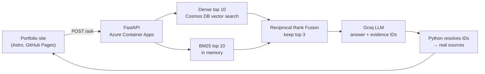

# Ask Bach

**A chatbot on my portfolio that answers questions about my experience, projects and research, and shows the sources behind every answer.**

**[Try it on my portfolio →](https://bachnguyennn.github.io)** · [Live API docs](https://ask-bach-api.yellowbush-fb5a973b.canadacentral.azurecontainerapps.io/docs) *(the first request after idle can take a few seconds while the server wakes up)*

[](https://github.com/bachnguyennn/AskBachBot/actions/workflows/ci.yml)


<!-- TODO: add a 10–15 s GIF of the widget answering a question with sources -->

```http
POST /ask   {"question": "What did Bach do at CMHA?"}
```
```json
{
  "answer": "Bach was an IT intern at CMHA Durham and built Power Apps and Power Automate booking workflows that eliminated double-bookings and saved staff 5+ hours a week ...",
  "sources": [{"source": "cmha.txt", "chunk_id": 3}, {"source": "cmha.txt", "chunk_id": 2}]
}
```

If the knowledge base doesn't cover a question, it says so instead of guessing, and cites nothing.

## What I built

- **Hybrid retrieval.** Semantic search (MiniLM embeddings in Azure Cosmos DB vector search) and keyword search (BM25), merged with Reciprocal Rank Fusion. Each method catches questions the other misses.
- **Sources the model can't invent.** The LLM (Groq, strict JSON schema) returns only integer evidence IDs; Python maps them to the real passages. Whether every sentence is supported by its source isn't measured yet; that's next on the [roadmap](docs/technical-deep-dive.md#roadmap).
- **Measured, not tuned by feel.** A hand-labelled retrieval benchmark runs in CI on every push and fails the build if quality drops.
- **Built to stay up on a $0 budget.** Clean `503` fallback when an upstream service fails, per-IP rate limiting to protect the free LLM quota, keyless auth to Azure via managed identity, CPU-only container image with the model baked in.

## How it works



## Results

Retrieval on a 10-question benchmark (5 questions + 5 paraphrases) over 115 chunks from 21 documents. Higher is better.

| | Dense only | Keyword (BM25) only | **Hybrid** |
|---|---|---|---|
| Found useful evidence in the top 3 (Recall@3) | 8/10 | 9/10 | **10/10** |
| Share of the top 3 that is relevant (Precision@3) | 47% | **63%** | 60% |
| How early the first good passage appears (MRR@3) | 0.750 | 0.800 | **0.883** |

In plain terms: hybrid retrieval is the only setup that finds supporting evidence for every test question, and it ranks that evidence highest. The benchmark is small and I wrote it myself, so treat it as a regression check, not proof of general quality. The [full evaluation](docs/technical-deep-dive.md#evaluation) covers its limits and the one question it still struggles with.

## Run it locally

```bash
python3.12 -m venv .venv && source .venv/bin/activate
pip install -r app/requirements-dev.txt
cd app
pytest                                  # unit + API tests (LLM and database mocked)
python -m eval.retrieval_eval           # retrieval benchmark, no cloud access needed
uvicorn src.api:app --reload            # needs GROQ_API_KEY and `az login` for Cosmos DB
```

## Documentation

- **[Technical deep dive](docs/technical-deep-dive.md):** the full pipeline, API reference, Azure deployment, evaluation, experiment log, design decisions and known limitations
- **[ADR 0001](docs/adr/0001-move-knowledge-base-to-cosmos-db.md):** why the knowledge base moved to Cosmos DB

## License

Code: [MIT](LICENSE). The personal documents in `app/data/documents/` are not licensed for reuse; see [NOTICE](NOTICE).
