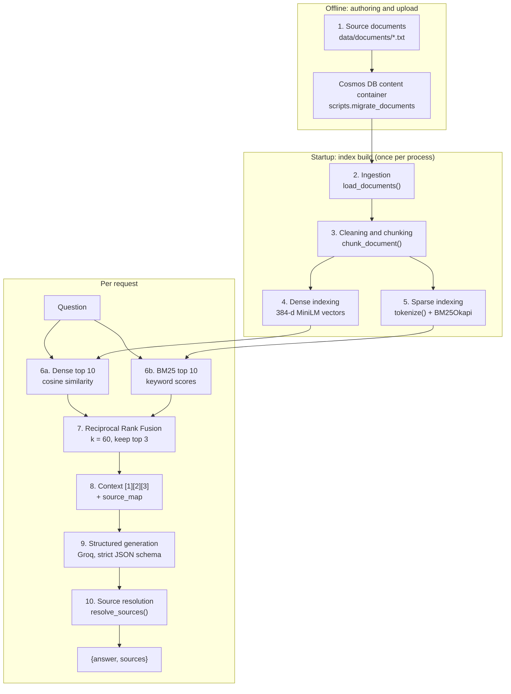
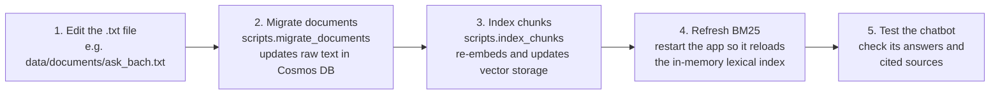

# Ask Bach: technical deep dive

> The full engineering write-up. For the short version, see the [README](../README.md).

**A production-deployed retrieval-augmented generation (RAG) service that answers questions about Bach Nguyen's experience, research, education and projects, with citations resolved by application code rather than invented by the model.**


## Why I built this

Ask Bach is a production-oriented RAG system built to explore the **full lifecycle of an AI application**: document ingestion, dense and lexical retrieval, hybrid ranking, grounded generation, structured citations, retrieval evaluation, API design, containerization, cloud deployment, secret management and front-end integration. It powers the "Ask Bach" feature of my portfolio site, but the real goal was to build every layer myself and **measure** each decision instead of guessing.

### What it does

A visitor asks a question; the service retrieves the most relevant passages from a curated knowledge base, has an LLM answer **only from those passages**, and returns the answer with **sources validated in Python**:

```http
POST /ask
Content-Type: application/json

{"question": "What did Bach do at CMHA?"}
```

```json
{
  "answer": "Bach was an IT intern at the Canadian Mental Health Association (CMHA) Durham, where he built Power Apps and Power Automate booking workflows that eliminated double-bookings ...",
  "sources": [
    {"source": "cmha.txt", "chunk_id": 3},
    {"source": "cmha.txt", "chunk_id": 2}
  ]
}
```

When the knowledge base does not contain the answer, it declines instead of guessing, and cites nothing:

```json
{"answer": "I do not have enough information about that. Would you like to contact Bach for a discussion?", "sources": []}
```

### Highlights

- **Hybrid retrieval:** MiniLM dense search + BM25, merged with Reciprocal Rank Fusion.
- **Source metadata the model cannot fabricate:** the LLM returns integer evidence IDs only; Python maps them to real documents. (Whether each *claim* is supported by its cited chunk is a separate question, not yet measured; see [Known limitations](#known-limitations).)
- **Strict structured output:** JSON-schema-constrained generation, so there is no parsing of free text.
- **Measured, not tuned by feel:** each retrieval change was tested one variable at a time against a frozen benchmark, and the [limitations of that benchmark](#interpreting-the-numbers) are stated explicitly.
- **Deployed:** Docker image in Azure Container Registry, running on Azure Container Apps, pulled with a managed identity, and called over HTTPS from a GitHub Pages / Astro front end.

> **Status (2026-11-04):** live in production (`ask-bach-api:v6`, Cosmos DB-backed) and called by the portfolio site. Tests, a retrieval-eval regression gate and lint run in GitHub Actions on every push.

---

## Repository structure

```
.
├── app/                         # Python project root (run commands from here)
│   ├── data/documents/          # Knowledge base source: 21 plain-text documents (uploaded to Cosmos DB)
│   ├── eval/
│   │   ├── benchmark.py         # Frozen questions + hand-labelled relevant chunks
│   │   ├── retrieval_eval.py    # Dense vs BM25 vs Hybrid (Recall/Precision/MRR @3); CI regression gate
│   │   └── retrieval_results.json
│   ├── scripts/                 # Offline Cosmos DB jobs (python -m scripts.<name>)
│   │   ├── migrate_documents.py # Upsert .txt files → `content` container
│   │   ├── index_chunks.py      # Chunk + embed → `chunks` container (vector-indexed)
│   │   └── add_experience.py    # Upsert a portfolio experience record
│   ├── src/
│   │   ├── api.py               # FastAPI app: routes, warm-up, rate limiting, 503 fallback, CORS
│   │   ├── rag.py               # ★ Pipeline orchestrator: answer_question()
│   │   ├── hybrid_retriever.py  # HybridRetriever + Reciprocal Rank Fusion
│   │   ├── dense_retriever.py   # MiniLM embeddings: Cosmos DB VectorDistance or in-memory index
│   │   ├── bm25_retriever.py    # Tokenizer, BM25 index and retriever
│   │   ├── load_documents.py    # Load documents (Cosmos DB or disk), clean and chunk
│   │   ├── generate.py          # Groq client, structured generation
│   │   ├── rate_limit.py        # In-memory sliding-window rate limiter
│   │   └── database.py          # Lazy Cosmos DB client (Entra ID via DefaultAzureCredential)
│   ├── tests/                   # pytest: retrieval, chunking, RAG, API (Groq/Cosmos mocked)
│   ├── pyproject.toml           # pytest + ruff config
│   ├── requirements.txt         # Pinned runtime dependencies
│   ├── requirements-dev.txt     # + pytest, ruff
│   ├── vector-policy.json       # Cosmos DB vector embedding policy for `chunks`
│   └── index-policy.json        # Cosmos DB indexing policy for `chunks`
├── .github/workflows/ci.yml     # Lint, tests, retrieval eval gate
├── docs/
│   ├── technical-deep-dive.md   # This document
│   └── adr/                     # Architecture Decision Records
├── frontend/                    # Example Astro component that calls the content API
├── Dockerfile                   # Production image (CPU-only torch, model baked in)
├── LICENSE                      # MIT, covers the code
├── NOTICE                       # Rights reserved on the personal documents
└── README.md
```

**`app/` is the Python project root.** Modules import each other as `src.*`, so commands run from `app/` as modules, e.g. `python -m src.rag` or `uvicorn src.api:app`. This mirrors the container, where `app/` becomes `/app`.

**Where to start reading:** `app/src/rag.py`. `answer_question()` calls every pipeline stage in order, and `app/src/api.py` is a thin HTTP wrapper around it.

---

## Table of contents

- [System architecture](#system-architecture)
- [Request lifecycle: one question, end to end](#request-lifecycle-one-question-end-to-end)
- [Data pipeline](#data-pipeline)
- [Knowledge base](#knowledge-base)
- [Getting started](#getting-started)
- [Configuration reference](#configuration-reference)
- [HTTP API reference](#http-api-reference)
- [Python API reference](#python-api-reference)
- [Running with Docker](#running-with-docker)
- [Azure deployment](#azure-deployment)
- [Deployment lessons learned](#deployment-lessons-learned)
- [Evaluation](#evaluation)
- [Experiment log](#experiment-log)
- [Design decisions](#design-decisions)
- [Security and privacy](#security-and-privacy)
- [Performance characteristics](#performance-characteristics)
- [Known limitations](#known-limitations)
- [Roadmap](#roadmap)
- [Troubleshooting](#troubleshooting)
- [License](#license)
- [Acknowledgements](#acknowledgements)

---

## System architecture

```
GitHub Pages / Astro front end  (bachnguyennn.github.io)
        │  HTTPS  POST /ask
        ▼
Azure Container Apps            (Canada Central)
  - Consumption workload profile
  - External ingress → target port 8000
  - 1 vCPU / 2 GiB
  - Image pulled from Azure Container Registry via user-assigned managed identity
  - GROQ_API_KEY injected from a Container Apps secret (secretref)
        │
        ▼
Docker container                (python:3.12-slim, linux/amd64)
        │
        ▼
FastAPI + Uvicorn               (src/api.py)
        │                          ┌─────────────────────────────────────────────┐
        │  at startup: documents   │ Azure Cosmos DB for NoSQL   (Central US)    │
        │ ◄─────────────────────── │  db ask-bach: content, chunks (vector)      │
        │  (main branch only)      └─────────────────────────────────────────────┘
        ▼
Hybrid RAG                      (src/rag.py → dense + BM25 → RRF → context)
        │  prompt + JSON schema
        ▼
Groq API                        (openai/gpt-oss-120b, strict structured output)
```

**Responsibilities by layer:**

| Layer | Component | Decides |
|---|---|---|
| Transport | `src/api.py` (FastAPI) | Whether the request is valid and allowed (schema, length, CORS). |
| Retrieval | `src/hybrid_retriever.py` | Which 3 chunks the model gets to see. |
| Generation | `src/generate.py` (Groq LLM) | What to say, and which evidence IDs it claims to have used. |
| Validation | `src/rag.py` (`resolve_sources`) | Whether those IDs are valid, and which real document chunk each one refers to. |
| Presentation | Portfolio front end | How the answer and sources are displayed. |

---

## Request lifecycle: one question, end to end

The trace below follows a real query from the 2026-10-06 evaluation run (33-chunk corpus). On today's 122-chunk corpus the hybrid top 3 for this question is unchanged: cmha c3, cmha c2, about c0.

```
"What did Bach do at CMHA?"
        │
        ▼
MiniLM query embedding (384-d)            BM25 tokens → ['bach', 'at', 'cmha']
        │                                         │
        ▼                                         ▼
Dense top 10 (cosine)                     BM25 top 10
  1. cmha.txt      c3  0.4842               1. cmha.txt  c3  4.2072
  2. education.txt c3  0.4838               2. cmha.txt  c2  3.9706
  3. about.txt     c0  0.4764               3. cmha.txt  c0  3.6888
  ...                                       ...
        └──────────────────┬──────────────────┘
                           ▼
Reciprocal Rank Fusion (k = 60) → top 3
  1. cmha.txt c3  0.0328
  2. cmha.txt c2  0.0313
  3. about.txt c0 0.0306
                           │
                           ▼
Context sent to the LLM           source_map kept in Python (never sent)
  [1] <cmha c3 text>                1 → cmha.txt  chunk 3
  [2] <cmha c2 text>                2 → cmha.txt  chunk 2
  [3] <about c0 text>               3 → about.txt chunk 0
                           │
                           ▼
Groq structured output (strict JSON schema)
  {"answer": "...", "used_context": [1, 2]}
                           │
                           ▼
resolve_sources([1, 2], source_map)
  → cmha.txt chunk 3, cmha.txt chunk 2
                           │
                           ▼
API response
  {"answer": "...", "sources": [{"source": "cmha.txt", "chunk_id": 3},
                                {"source": "cmha.txt", "chunk_id": 2}]}
```

Two observations from this trace:

- **Fusion at work.** Dense search alone ranked an unrelated education chunk second. BM25 ranked three CMHA chunks at the top, and RRF combined the two lists into a context that is mostly CMHA evidence.
- **The model chose its evidence.** It cited [1] and [2] and skipped the weaker general-profile chunk [3].

> **Core design decision:** The model returns only integer evidence IDs. Source filenames and chunk IDs are resolved by application code after generation. This prevents the model from fabricating source metadata, although it does not by itself guarantee claim-level groundedness.

The last sentence matters. In testing, the model wrote that Bach *"saved more than five staff hours per week **for over 100 staff**"*. Both facts appear in the cited CMHA chunk, but the source never states that relationship between them. The citation was valid; the claim was not fully supported. See [Known limitations](#known-limitations).

---

## Data pipeline

This section documents every step data goes through, from a hand-written text file to the JSON returned to the browser.



### Pipeline lifecycle

| Phase | When it runs | What happens | Cost |
|---|---|---|---|
| **Authoring** | Manually, when profile information changes | Edit or add `.txt` files in `app/data/documents/`, then upload them to Cosmos DB (see [Adding or updating a document](#adding-or-updating-a-document)). | A few RUs per upsert. |
| **Image build** | `docker buildx build` | Code is copied into the image with a CPU-only PyTorch build, and the embedding model is downloaded into the image. Indexes are **not** precomputed. | One-off. |
| **Startup** | FastAPI lifespan warm-up (container start or `uvicorn` launch) | The embedding model is loaded from the image, documents are queried from Cosmos DB **once** and chunked, and the BM25 index is built. A warm-up failure is logged, not fatal; the next request retries. | Warm-up about 7 s in production. A cold request (scale from zero) takes **10.6 s**, down from 32 s before the Dockerfile change (single measurements, 2026-11-04). | |
| **Request** | Every `POST /ask` | Retrieval, fusion, context assembly, one LLM call, source resolution. | Retrieval takes milliseconds; the Groq call dominates (about 0.4–1.3 s observed). |

**Dense retrieval runs in Cosmos DB.** Chunk embeddings are computed offline by `scripts.index_chunks` and stored in the `chunks` container, and `HybridRetriever` gets its dense candidates from a `VectorDistance` query (`retrieve_dense_cosmos` in `src/dense_retriever.py`), one Cosmos DB query per request. The BM25 index lives in process memory. The offline eval and tests swap in `InMemoryDenseIndex`, which gives identical rankings because the Cosmos DB index is `flat` (exact).

### Stage 1: Source documents

**Location:** `app/data/documents/` (authoring copy) → Cosmos DB `ask-bach/content` (runtime copy). 21 hand-written plain-text files. They are the **only** source of truth the model can draw on. See [Knowledge base](#knowledge-base).

### Stage 2: Ingestion

**Function:** `load_documents_from_cosmos()` in `src/load_documents.py` (`load_documents_from_disk()` reads the `.txt` files for the offline eval and tests)

- Queries `SELECT c.source, c.text FROM c WHERE c.type = 'document'` on the `content` container (cross-partition; the partition key is `/type`).
- Skips items with empty text, then **sorts by `source`**. Cosmos DB doesn't guarantee result order, so this sort is what keeps chunk numbering deterministic.
- Authenticates with `DefaultAzureCredential` (`src/database.py`): your `az login` session locally, and a managed identity in Azure.

**Output:** `[{"source": "about.txt", "text": "<full file text>"}, ...]`

### Stage 3: Cleaning and chunking

**Function:** `chunk_document(doc, max_chars=1200)` in `src/load_documents.py`

1. **Divider removal:** lines made only of `=` characters are dropped. Blank lines are kept, because they mark paragraph boundaries.
2. **Title extraction:** the first remaining line is the document title, e.g. `IT INTERN — CANADIAN MENTAL HEALTH ASSOCIATION (CMHA DURHAM)`.
3. **Paragraph split:** the rest is split on blank lines into paragraphs.
4. **Greedy packing:** paragraphs are appended to the current chunk until the next one would push the body past 1,200 characters; then a new chunk starts.
5. **Title prefixing:** the document title is prepended to **every** chunk, so a chunk from the middle of `cmha.txt` still states what it is about. This helps both the embedding model and BM25.
6. **Identity assignment:** `chunk_id` is the chunk's 0-based position within its document.

**Edge cases:** a single paragraph longer than `max_chars` becomes its own oversized chunk and is never split. `max_chars` limits the body *before* the title is added, so chunks can exceed 1,200 characters (the current maximum is 1,268).

**Output:**

```python
{"source": "cmha.txt", "chunk_id": 3, "text": "IT INTERN — CANADIAN MENTAL HEALTH ...\n\n- Where did Bach intern? ..."}
```

`(source, chunk_id)` is the chunk's **stable identity** across fusion, evaluation labels, the source map and the API response.

> ⚠️ **Chunk IDs are derived, not stored.** Editing a document or changing `max_chars` can renumber chunks and invalidate the relevance labels in `app/eval/benchmark.py`. `tests/test_benchmark.py` fails if a label points at a chunk that no longer exists, but a renumbered chunk that still exists can't be caught automatically, so re-check the labels after any such change.

### Stage 4: Dense indexing

**Module:** `src/dense_retriever.py`

- Model: [`sentence-transformers/all-MiniLM-L6-v2`](https://huggingface.co/sentence-transformers/all-MiniLM-L6-v2), loaded once, lazily (`get_model()`), and baked into the Docker image.
- Each chunk's full text (title included) is encoded into a **384-dimensional** vector by `scripts.index_chunks` and stored in Cosmos DB.
- `InMemoryDenseIndex` holds the same vectors in a NumPy array for the offline eval; brute-force search is exact and fast at this size.

### Stage 5: Sparse (BM25) indexing

**Module:** `src/bm25_retriever.py`, using `rank_bm25.BM25Okapi` with default parameters (`k1=1.5`, `b=0.75`). Chunks and queries share one tokenizer:

```python
tokenize("What programming languages does Bach know?")
# → ['programming', 'languages', 'bach', 'know']
```

1. Lowercase, then `re.findall(r"\w+", ...)`, which drops punctuation (`"languages:"` → `languages`, `C++` → `c`, `Bach's` → `bach`, `s`).
2. Remove a 25-word stopword list (`STOPWORDS`): articles, forms of *be/do/have*, question words and common prepositions.
3. **No stemming**, so `researching` does not match `research`.
4. **`bach` is deliberately kept.** Removing it was tested; see the [Experiment log](#experiment-log).

### Stage 6: Candidate retrieval

Both retrievers return the same shape, `[(chunk, score), ...]` sorted by descending score, which keeps fusion simple.

| Retriever | Function | Score | Depth |
|---|---|---|---|
| Dense | `retrieve_dense_cosmos(query, k)` or `InMemoryDenseIndex.search(query, k)` | Cosine similarity | `candidate_k = 10` |
| BM25 | `retrieve_bm25(query, chunks, bm25, k)` | BM25 Okapi score | `candidate_k = 10` |

**Why retrieve 10 when only 3 are used?** In testing, correct evidence often sat at rank 4 or 5 in one retriever. Fusing only each retriever's top 3 would discard it before fusion could promote it. Candidate depth does not have to equal context size.

### Stage 7: Reciprocal Rank Fusion

**Function:** `reciprocal_rank_fusion(*rankings, rrf_k=60)` in `src/hybrid_retriever.py`

$$\text{RRF}(c) = \frac{1}{k + \text{rank}_\text{dense}(c)} + \frac{1}{k + \text{rank}_\text{BM25}(c)}, \qquad k = 60$$

- A chunk missing from one list gets no contribution from it.
- Chunks are matched across lists by `(source, chunk_id)`, never by text.
- RRF uses **ranks only**, so the dense and BM25 scores, which are on completely different scales, never need to be normalised.
- `retrieve_hybrid(query, candidate_k=10, final_k=3, rrf_k=60)` returns the top `final_k`; `final_k=None` returns the full fused ranking (used by the evaluation).

**Known property:** RRF ignores score magnitude, so a confident ranking and a near-tie contribute identically. Fusion also cannot fix cases where both retrievers rank the same wrong chunks highly.

### Stage 8: Context assembly and source map

**Function:** `build_context_and_source_map(results)` in `src/rag.py`

This produces two parallel structures from the top 3 chunks. The model sees evidence IDs and chunk text in the context string. Python keeps the source map, `{1: {"source": "cmha.txt", "chunk_id": 3}, ...}`, which never enters the prompt. See the [request lifecycle](#request-lifecycle-one-question-end-to-end) for a concrete example.

The prompt (`build_structured_prompt`) instructs the model to answer only from the context, to say when it does not have enough information, to list the evidence IDs it actually used in `used_context`, and not to put citation markers in the answer text.

### Stage 9: Structured generation

**Function:** `generate_structured(prompt)` in `src/generate.py`

- **Provider:** [Groq](https://console.groq.com). **Model:** `openai/gpt-oss-120b` (constant `MODEL`).
- **Authentication:** `GROQ_API_KEY` from the process environment. It is never in code or in the image.
- **Output contract:** Groq structured outputs in **strict** JSON-schema mode:

```python
ANSWER_SCHEMA = {
    "type": "object",
    "properties": {
        "answer": {"type": "string"},
        "used_context": {"type": "array", "items": {"type": "integer"}},
    },
    "required": ["answer", "used_context"],
    "additionalProperties": False,
}
```

> **Schema validation checks structure, not truth.** `{"answer": "Bach worked at Google.", "used_context": [999]}` is schema-valid. That is why Stage 10 exists.

### Stage 10: Source resolution

**Function:** `resolve_sources(used_context, source_map)` in `src/rag.py`

| Model returns | Result | Rationale |
|---|---|---|
| `[1, 3]` | sources for 1 and 3, in that order | Normal case. |
| `[1, 999]` | source for 1 only | Invalid IDs are ignored. They are tolerated for now so model behaviour can be observed; this may become a hard failure. |
| `[1, 1]` | source for 1 once | Duplicates are removed. |
| `[]` | `[]` | No evidence used, e.g. a refusal. |

**Guaranteed:** every returned source is a chunk that was actually retrieved and shown to the model for this question.
**Not guaranteed:** that the chunk supports every sentence of the answer.

### Data shapes at each stage

| Stage | Produced by | Shape |
|---|---|---|
| Document | `load_documents` | `{"source": str, "text": str}` |
| Chunk | `chunk_document` | `{"source": str, "chunk_id": int, "text": str}` |
| Dense index | Cosmos DB `chunks` container (or `InMemoryDenseIndex`) | 122 × 384-d vectors |
| BM25 index | `HybridRetriever` (built once, `get_retriever()`) | `BM25Okapi` over `list[list[str]]` |
| Candidates | `HybridRetriever.dense`, `HybridRetriever.lexical` | `list[tuple[chunk, float]]`, length 10 |
| Fused results | `retrieve_hybrid` | `list[tuple[chunk, float]]`, length 3 |
| Context | `build_context_and_source_map` | `str` with `[1]`, `[2]`, `[3]` blocks separated by `---` |
| Source map | `build_context_and_source_map` | `dict[int, {"source": str, "chunk_id": int}]` |
| Model output | `generate_structured` | `{"answer": str, "used_context": list[int]}` |
| API response | `answer_question` | `{"answer": str, "sources": list[{"source": str, "chunk_id": int}]}` |

---

## Knowledge base

### Documents

| File | Covers | Chunks |
|---|---|---|
| `about.txt` | Profile, short bio, experience summary, technical skills, working style, what Bach is looking for, contact links | 5 |
| `ask_bach.txt` | This chatbot: architecture, pipeline, hybrid retrieval, citations, evaluation, deployment, security, content API, lessons | 12 |
| `azure.txt` | Statistics Without Borders Azure pipeline work, Hack Hive Azure challenge, cloud and data-engineering skills | 3 |
| `blog.txt` | Blog posts | 1 |
| `cmha.txt` | IT internship at CMHA Durham: overview, data management and reporting, IT support, lessons learned | 4 |
| `education.txt` | Degree, coursework, certifications, thesis summary, TA role, campus leadership | 4 |
| `projects.txt` | Index of all projects, Bach's methodology, projects grouped by topic | 5 |
| `project_*.txt` (14 files) | One detailed document per project: Alpaca options agent, AstroLoc-ML, Benford fraud detection, chest X-ray, CViT-CPG, data engineering ETLs, energy forecasting, FastText, GrammarMe, hospital readmission, MarketGuard, Nested Learning, Quant Research Terminal, xG betting | 84 |
| `research.txt` | Undergraduate thesis on continual learning for CascadedViT: the problem, why CViT, the research question (ongoing, results not yet public) | 4 |
| **Total** | **≈ 97.1 KB of text, 22 documents** | **122** |

### Authoring conventions

The chunker depends on these rules:

1. **The first line is the document title.** It is prepended to every chunk, so make it descriptive.
2. **Separate paragraphs with one blank line.** Keep each paragraph under about 1,000 characters so it can share a chunk.
3. **`=====` divider lines are allowed**; they are stripped automatically.
4. **Write in the third person and name the subject** ("Bach built ..."), so chunks read correctly out of context.
5. **End sections with a `QUICK FACTS (FOR COMMON QUESTIONS)` block** of short Q&A lines. These improve retrieval for direct questions, but they also act as "hubs" that rank for many queries, so keep them specific.
6. **Only write facts that are fine to repeat publicly.** Anything here can appear in an answer.

### Adding or updating a document



1. Edit or add a `.txt` file in `app/data/documents/`.
2. From `app/` (signed in with `az login`), upload it with `python -m scripts.migrate_documents`, then re-embed with `python -m scripts.index_chunks`. Order matters: `index_chunks` reads documents from Cosmos DB, not from disk.
3. Check chunking with `python -m src.load_documents` and run `pytest`: `test_benchmark.py` fails if an eval label now points at a missing chunk.
4. If chunk IDs moved, update the labels in `eval/benchmark.py`, re-run `python -m eval.retrieval_eval`, and compare against the [published results](#retrieval-evaluation).
5. Let the app rebuild its in-memory indexes. It rebuilds them on every start, and it scales to zero when idle, so if `az containerapp replica list -g $RG -n $APP --revision <latest>` is empty, the next question picks up the new content. `az containerapp revision restart` does not work here: Express environments reject it, and the CLI has no `az containerapp stop` or `start` (checked with azure-cli 2.90.0, containerapp 1.3.0b5). If replicas are running, wait for them to scale down or deploy a new revision. You don't need to rebuild the image just for a content change.

> ⚠️ `migrate_documents` only **upserts**. If you delete or rename a `.txt` file, also delete its item from the `content` container, or the old document will keep being served. `index_chunks` then removes any chunk in `chunks` that no longer matches a current document chunk (stale chunks from shrunk, renamed or deleted documents). See [ADR 0001 → Updating content](adr/0001-move-knowledge-base-to-cosmos-db.md#updating-content).

---

## Getting started

### Prerequisites

| Requirement | Notes |
|---|---|
| Python **3.12** | Matches the Docker base image. |
| A Groq API key | Free at [console.groq.com/keys](https://console.groq.com/keys). |
| Azure CLI, signed in (`az login`) | The app reads its documents from Cosmos DB with your Entra ID identity. That identity needs the **Cosmos DB Built-in Data Contributor** role (or a reader role) on the account. |
| About 2 GB of disk | Mostly PyTorch. The embedding model (about 90 MB) downloads from Hugging Face on first run. |
| Docker with Buildx *(optional)* | Only needed to build or deploy the container. |

### Install

```bash
git clone <repository-url> ask-bach
cd ask-bach

python3.12 -m venv .venv
source .venv/bin/activate          # Windows: .venv\Scripts\activate
pip install torch==2.14.1 --index-url https://download.pytorch.org/whl/cpu   # optional: smaller CPU-only build
pip install -r app/requirements-dev.txt   # runtime deps + pytest + ruff
```

### Configure

The application reads `GROQ_API_KEY` from the **process environment**. For local development only, `src/generate.py` also loads a `.env` file from the **repository root** if one exists. The file is git-ignored, and real environment variables always take precedence over it.

```bash
echo "GROQ_API_KEY=<your-groq-api-key>" > .env
```

In Docker and Azure, no `.env` file is involved; the key is supplied by the runtime.

Cosmos DB needs no key. `src/database.py` uses `DefaultAzureCredential`, which picks up your `az login` session locally. The account endpoint comes from `COSMOS_ENDPOINT` (it defaults to the production account).

### Run the API locally

```bash
cd app
uvicorn src.api:app --reload --port 8000
```

Startup takes a few seconds while the warm-up loads the model and builds the index; the log shows `warmup ok: 122 chunks in …s`. Then:

```bash
curl -s http://localhost:8000/
# {"status":"Ask Bach API is running"}

curl -s -X POST http://localhost:8000/ask \
     -H "Content-Type: application/json" \
     -d '{"question": "What Azure experience does Bach have?"}'
```

Interactive API docs: <http://localhost:8000/docs> (Swagger UI) and <http://localhost:8000/redoc>.

### Run the modules as scripts

Run these from `app/`:

| Command | What it does | Calls the LLM? |
|---|---|---|
| `pytest` | Unit and API tests; Groq and Cosmos DB are mocked | No |
| `ruff check .` | Lint | No |
| `python -m eval.retrieval_eval` | Retrieval eval on local documents (no Azure); writes `eval/retrieval_results.json` | No |
| `python -m eval.retrieval_eval --backend cosmos` | Same eval against live Cosmos DB (parity check) | No |
| `python -m src.load_documents` | Number of chunks created from the local documents | No |
| `python -m src.rag` | Two verbose end-to-end answers | Yes (2 calls) |
| `python -m scripts.migrate_documents` | Upserts every `.txt` file into Cosmos DB `content` | No (writes to Cosmos DB) |
| `python -m scripts.index_chunks` | Chunks, embeds and upserts all chunks into Cosmos DB `chunks`, then deletes stale chunks | No (writes to Cosmos DB) |

---

## Configuration reference

### Environment variables

| Variable | Required | Purpose |
|---|---|---|
| `GROQ_API_KEY` | **Yes** | Authenticates calls to the Groq API. In Azure it comes from the `groq-api-key` Container Apps secret. |
| `HF_TOKEN` | No | Hugging Face token; only needed if model downloads are rate-limited. |
| `AZURE_CLIENT_ID` | In Azure | Client ID of the user-assigned managed identity that `DefaultAzureCredential` should use for Cosmos DB. Not needed locally. |
| `COSMOS_ENDPOINT` | No | Cosmos DB account endpoint. Defaults to the production account. |
| `RATE_LIMIT_PER_MINUTE` | No | `/ask` requests allowed per client IP per minute. Default `10`. |
| `GROQ_MODEL` | No | Groq model ID. Default `openai/gpt-oss-120b`. |

### Tunable parameters

These are code constants. Changing retrieval parameters invalidates comparisons with the published evaluation.

| Parameter | Value | Location | Effect |
|---|---|---|---|
| `max_chars` | `1200` | `load_documents.py` | Maximum chunk body size before the title is prepended. |
| Embedding model | `all-MiniLM-L6-v2` | `dense_retriever.py` | Dense representation (384-d). |
| `STOPWORDS` | 25 words | `bm25_retriever.py` | Tokens dropped before BM25 scoring. |
| `candidate_k` | `10` | `answer_question`, `retrieve_hybrid` | Candidates per retriever before fusion. |
| `rrf_k` | `60` | `retrieve_hybrid` | RRF smoothing constant (the standard value from the original paper). |
| `final_k` | `3` | `answer_question`, `retrieve_hybrid` | Chunks sent to the LLM. |
| `MODEL` | `openai/gpt-oss-120b` | `generate.py` (`GROQ_MODEL`) | Groq model ID. Groq client timeout 20 s, 1 retry. |
| Rate limit | 10 / min / IP | `api.py` (`RATE_LIMIT_PER_MINUTE`) | Protects the Groq free-tier quota. |
| CORS origins | see [CORS](#cors) | `api.py` | Browser origins allowed to call the API. |
| Question length | 1–500 chars | `api.py` | Request validation bounds. |

---

## HTTP API reference

### `GET /`

Liveness check. The app warms up (model, documents, BM25 index) before it starts serving; if the warm-up fails, it still serves and `/ask` retries the load.

```json
{"status": "Ask Bach API is running"}
```

### `POST /ask`

**Request body** (`application/json`)

| Field | Type | Constraints |
|---|---|---|
| `question` | string | Required. Whitespace is stripped **before** validation; the result must be 1–500 characters. |

**Response `200 OK`**

| Field | Type | Description |
|---|---|---|
| `answer` | string | The answer, with no inline citation markers. A refusal is a normal answer, not an error. |
| `sources` | array | Chunks the model reported using, validated against what was retrieved. Empty for refusals. |
| `sources[].source` | string | Document filename, e.g. `"cmha.txt"`. |
| `sources[].chunk_id` | integer | 0-based chunk index within that document. |

**Status codes**

| Code | When |
|---|---|
| `200` | Success, including refusals. |
| `422` | Missing `question`, wrong type, empty or whitespace-only, or over 500 characters. FastAPI's standard `{"detail": [...]}` body. |
| `429` | More than `RATE_LIMIT_PER_MINUTE` questions from one client IP in 60 s. Includes a `Retry-After` header. |
| `503` | Groq or Cosmos DB failed (invalid key, retired model, upstream rate limit, timeout, network). The body is still `{"answer": <friendly fallback>, "sources": [], "error": "upstream_unavailable"}`, so the widget can display it. The traceback is logged. |

**Example: front-end call**

```js
const res = await fetch(`${API_URL}/ask`, {
  method: "POST",
  headers: { "Content-Type": "application/json" },
  body: JSON.stringify({ question }),
});
const body = await res.json();
// 200: answer; 503: friendly fallback in body.answer; 429/422: body.detail
const answer = body.answer ?? body.detail ?? "Something went wrong.";
```

**Example: validation error** for `{"question": "   "}`:

```json
{
  "detail": [{
    "type": "string_too_short",
    "loc": ["body", "question"],
    "msg": "String should have at least 1 character",
    "input": "   ",
    "ctx": {"min_length": 1}
  }]
}
```

### CORS

| Allowed origin | Purpose |
|---|---|
| `https://bachnguyennn.github.io` | Production portfolio (GitHub Pages) |
| `http://localhost:4321` | Local Astro dev server |

Only `POST` with the `Content-Type` header is allowed cross-origin, and credentials are disabled. CORS restricts browsers only; it is not authentication.

### OpenAPI

FastAPI serves `/openapi.json`, `/docs` (Swagger UI) and `/redoc`.

---

## Python API reference

```python
# run from app/
from src.rag import answer_question

response = answer_question("What Azure experience does Bach have?")
```

### `answer_question(question, candidate_k=10, final_k=3, verbose=False) -> dict`

| Parameter | Type | Default | Description |
|---|---|---|---|
| `question` | `str` | — | Natural-language question. |
| `candidate_k` | `int` | `10` | Candidates per retriever before fusion. |
| `final_k` | `int` | `3` | Chunks sent to the model as context. |
| `verbose` | `bool` | `False` | Print the raw model JSON, source map, resolved sources and final response. |

**Returns** `{"answer": str, "sources": [{"source": str, "chunk_id": int}, ...]}`.
**Side effects:** one Groq API call. The first call builds the retriever (one Cosmos DB documents query) if the API warm-up hasn't already.
**Raises:** `groq` / Azure SDK exceptions on authentication, model or network errors. `POST /ask` turns these into a `503` with a fallback answer.

---

## Running with Docker

| Dockerfile step | Detail |
|---|---|
| Base image | `python:3.12-slim` |
| PyTorch | **CPU-only** wheel from the PyTorch index, installed first. The default Linux wheel bundles several GB of CUDA libraries this container never uses; dropping them took the compressed image from 3.26 GB (v5) to about 0.6 GB. |
| Dependencies | `requirements.txt` installed next, so the layer is cached when only code changes |
| Embedding model | Downloaded at **build** time, with `HF_HUB_OFFLINE=1` at runtime, so a cold start doesn't hit Hugging Face |
| Application | `app/src/` → `/app/src/` (documents come from Cosmos DB at runtime) |
| User | Runs as a non-root `appuser` |
| Port / command | `8000`, `python -m uvicorn src.api:app --host 0.0.0.0 --port 8000` |

The image contains **no secrets**; `.env` is never copied, and `.dockerignore` keeps it (and `.venv`, `.git`) out of the build context.

```bash
# Build for the same platform Azure runs (required on Apple Silicon)
docker buildx build --platform linux/amd64 -t ask-bach-api .

# Run locally
docker run --rm -p 8000:8000 --env-file .env ask-bach-api
```

---

## Azure deployment

### Production topology

| Component | Configuration |
|---|---|
| Front end | Astro site on GitHub Pages, calling the API over HTTPS |
| Compute | **Azure Container Apps**, `Consumption` workload profile, **Canada Central** |
| Ingress | External, HTTPS, target port `8000` |
| Resources | **1 vCPU / 2 GiB** per replica |
| Scaling | Default scale rule (min replicas 0), so the app scales to zero when idle |
| Image registry | **Azure Container Registry** (Basic), versioned tags (production: `ask-bach-api:v6`) |
| Registry auth | **User-assigned managed identity** with the `AcrPull` role; no registry passwords in the app |
| LLM credential | `groq-api-key` **Container Apps secret**, exposed to the container as `GROQ_API_KEY` via `secretref` |
| Knowledge base | **Azure Cosmos DB for NoSQL** `bach-rag-cosmos-central` (Central US, free tier, vector search on), database `ask-bach`, accessed with Entra ID. See [ADR 0001](adr/0001-move-knowledge-base-to-cosmos-db.md) for the setup and deployment steps. |

### Deploying from scratch

The commands below reproduce the production setup. Resource names match production except the registry name, which must be globally unique.

```bash
RG=ask-bach-rg
LOCATION=canadacentral
ACR=<your-registry-name>
IDENTITY=ask-bach-identity
ENV=ask-bach-api-env
APP=ask-bach-api
TAG=v1

# 1. Resource group, registry and managed identity
az group create -n $RG -l $LOCATION
az acr create -g $RG -n $ACR --sku Basic
az identity create -g $RG -n $IDENTITY

IDENTITY_ID=$(az identity show -g $RG -n $IDENTITY --query id -o tsv)
PRINCIPAL_ID=$(az identity show -g $RG -n $IDENTITY --query principalId -o tsv)
ACR_ID=$(az acr show -n $ACR --query id -o tsv)
az role assignment create --assignee $PRINCIPAL_ID --role AcrPull --scope $ACR_ID

# 2. Build locally for linux/amd64 and push
az acr login -n $ACR
docker buildx build --platform linux/amd64 -t $ACR.azurecr.io/$APP:$TAG --push .

# 3. Container Apps environment and app
az containerapp env create -g $RG -n $ENV -l $LOCATION

read -rs GROQ_KEY   # paste the key; keeps it out of shell history
az containerapp create -g $RG -n $APP --environment $ENV \
  --workload-profile-name Consumption \
  --image $ACR.azurecr.io/$APP:$TAG \
  --user-assigned $IDENTITY_ID \
  --registry-server $ACR.azurecr.io --registry-identity $IDENTITY_ID \
  --target-port 8000 --ingress external \
  --cpu 1.0 --memory 2.0Gi \
  --secrets groq-api-key="$GROQ_KEY" \
  --env-vars GROQ_API_KEY=secretref:groq-api-key

# 4. Public URL for the front end
az containerapp show -g $RG -n $APP --query properties.configuration.ingress.fqdn -o tsv
```

### Updating the deployment

Use a new, immutable tag for every release so a previous revision can be restored:

```bash
TAG=v3
docker buildx build --platform linux/amd64 -t $ACR.azurecr.io/$APP:$TAG --push .
az containerapp update -g $RG -n $APP --image $ACR.azurecr.io/$APP:$TAG
```

**Rotating the Groq key:**

```bash
az containerapp secret set -g $RG -n $APP --secrets groq-api-key="$NEW_GROQ_KEY"
```

The running replica keeps the old key until it restarts. Express environments reject `az containerapp revision restart`, so let the app scale to zero or deploy a new revision.

**Inspecting a failing revision:**

```bash
az containerapp revision list -g $RG -n $APP -o table
az containerapp logs show -g $RG -n $APP --tail 100
```

---

## Deployment lessons learned

Every one of these was hit in practice during the first deployment.

| # | Problem | Symptom | Resolution | Takeaway |
|---|---|---|---|---|
| 1 | **CPU architecture mismatch** | The image built on an Apple Silicon Mac was `linux/arm64`; Azure Container Apps runs `linux/amd64`, so the container could not start. | Rebuilt with `docker buildx build --platform linux/amd64`. | Always build for the target platform, not the laptop's. |
| 2 | **ACR Tasks unavailable** | The Azure for Students subscription blocks ACR Tasks, so cloud builds (`az acr build`, `az containerapp up --source`) failed. | Built the image locally and pushed it to ACR. | Subscription policy can rule out the "easy path". Local build + push is portable and works everywhere. |
| 3 | **Under-provisioned container** | At the initial 0.25 vCPU / 0.5 GiB, PyTorch + SentenceTransformers could not finish startup and the revision was marked unhealthy. | Increased to **1 vCPU / 2 GiB**. | Size containers for the model, not the web framework. Peak resident memory is about 600 MB after startup, plus import-time spikes. |
| 4 | **Secret handling** | The API needs `GROQ_API_KEY` at runtime. | Stored as a Container Apps **secret** and referenced with `secretref`; it is never baked into the image or committed. | Images are artifacts that get copied and cached; secrets belong in the runtime. |
| 5 | **Registry credentials** | The app needs to pull from a private registry. | A **user-assigned managed identity** with `AcrPull`, so there are no registry passwords in the app configuration. | Prefer identity-based access over shared keys. |
| 6 | **Cold start** | The app scales to zero. A cold request took **32 s** (measured 2026-11-04, image v5): pulling a multi-GB CUDA-enabled image, downloading the model, then building the index. | Dockerfile now uses CPU-only PyTorch and bakes the model into the image: the linux/amd64 image shrank from **3.26 GB to about 0.6 GB** compressed (measured 2026-11-04). The index is built once in a startup warm-up. Cold start fell from **32 s to 10.6 s** (v6, measured 2026-11-04). | `--min-replicas 1` would remove cold starts entirely but spends Azure credit around the clock. |

---

## Evaluation

Retrieval and generation fail in different ways, so they are evaluated separately. Today only retrieval is measured automatically.

### Retrieval evaluation

**Script:** `app/eval/retrieval_eval.py` (no LLM calls). **Benchmark:** `app/eval/benchmark.py`. **Output:** `app/eval/retrieval_results.json`.

It measures *question → retriever → top-3 evidence* for Dense, BM25 and Hybrid retrieval. Two backends give identical rankings: `--backend disk` (local `.txt` files, in-memory dense search, no Azure) and `--backend cosmos` (live Cosmos DB). **CI runs the disk backend on every push** with `--check`, which fails the build if Hybrid drops below the current scores.

**Benchmark:** 10 queries, made up of 5 original questions and 5 paraphrases. Paraphrases share their original's relevance labels because they ask for the same information. Three unanswerable questions are defined for future refusal testing but are not scored here.

**Relevance rule** (fixed before any results were seen): *a chunk is relevant if, on its own, it supports a correct and specific answer: it names the role, the concrete work, or the fact. A passing mention or a bare skill keyword does not count.* Relevance is a **set** of chunks per question, so a valid summary source is not penalised.

| Metric | Question it answers | Definition |
|---|---|---|
| **Recall@3** | Did we retrieve at least one useful piece of evidence? | Share of queries with ≥ 1 relevant chunk in the top 3. |
| **Precision@3** | How much of the context is relevant? | Relevant chunks in the top 3 ÷ (3 × queries). |
| **MRR@3** | How early does the first relevant evidence appear? | Mean of 1/rank of the first relevant chunk in the top 3 (0 if none). |

**Frozen configuration:** Dense = `all-MiniLM-L6-v2` + cosine. BM25 = regex tokenizer + stopwords, no stemming, `bach` kept. Hybrid = `candidate_k=10`, `rrf_k=60`, `final_k=3`.

**Results**

| Metric | Dense | BM25 | Hybrid |
|---|---|---|---|
| **v2: 2026-11-05, 22 documents / 122 chunks** | | | |
| Recall@3 | **10/10** | **10/10** | **10/10** |
| Precision@3 | 53% (16/30) | **67%** (20/30) | 60% (18/30) |
| MRR@3 | 0.883 | 0.833 | **0.933** |
| *v2: 2026-11-04, 21 documents / 115 chunks* | | | |
| Recall@3 | 8/10 | 9/10 | **10/10** |
| Precision@3 | 47% (14/30) | **63%** (19/30) | 60% (18/30) |
| MRR@3 | 0.750 | 0.800 | **0.883** |
| *v1: 2026-10-06, 6 documents / 33 chunks* | | | |
| Recall@3 | 8/10 | 10/10 | 10/10 |
| Precision@3 | 43% (13/30) | 73% (22/30) | 70% (21/30) |
| MRR@3 *(post hoc)* | 0.700 | 0.833 | 0.950 |

**Why the labels changed (v1 → v2).** The corpus grew from 6 to 21 documents, and `about.txt`, `education.txt` and `research.txt` were rewritten, so several v1 labels pointed at chunk IDs that no longer exist (v1 labelled `research.txt` chunks 5 and 6; it now has chunks 0–3). The v2 labels apply the same rule to the current chunks, were written before the v2 run, and add three chunks from new documents that describe concrete Azure work. The questions are unchanged. v1 and v2 are different corpora, so compare them as "same benchmark, harder haystack", not as a before/after of a retrieval change.

### Interpreting the numbers

> **The evaluation set is small (n = 10) and written by the corpus author. It is a regression check, not evidence of general retrieval quality.**

- **All three systems now find evidence for every question**, and hybrid has the best MRR. Dense only reached 10/10 after the `about.txt` skills line was reworded (experiment 14), and BM25 still has slightly better precision, so hybrid vs BM25 remains close.
- **Growing the corpus 3.5× cost precision and ranking quality** (Hybrid P@3 70% → 60%, MRR 0.950 → 0.883): more chunks compete for the same three slots.
- **"What is Bach researching?" is still the weak spot.** Every system passes only through the `about.txt` summary; no `research.txt` chunk reaches the top 3 even after the rewrite. `QUICK FACTS` hub chunks (`education.txt` c3, `about.txt` c4) take the top slots, and BM25 has no stemming (`researching` ≠ `research`). The paraphrase *"What topic is Bach's undergraduate thesis focused on?"* does retrieve `research.txt` c3.
- **The paraphrases are easier than real user questions.** Several reuse document wording.
- **Retrieval metrics say nothing about answer correctness.** Groundedness is not yet measured.

### Cosmos DB parity check

The `chunks` container uses a `flat` vector index, which is exact brute-force search, so Cosmos DB `VectorDistance` should rank exactly like in-memory cosine search.

- **2026-10-08 (v1 corpus):** dense retrieval on Cosmos DB returned the same top 3, in the same order, with the same scores to four decimal places, for all 10 questions.
- **2026-11-04 (v2 corpus):** `python -m eval.retrieval_eval --backend cosmos` reproduces the disk backend's Dense, BM25 and Hybrid results exactly. That is also what justifies running the eval offline in CI.

This holds only because the index is `flat`. Switching to `quantizedFlat` or `diskANN` would make search approximate, so rerun the check after any index change.

### End-to-end answer evaluation

Not automated yet. A one-off run on 2026-10-06 used the earlier dense-only, free-text pipeline: 4/5 answerable questions answered correctly (the miss was a retrieval failure), 3/3 unanswerable questions refused, 0.4–1.3 s per question. That script was removed because it no longer matched the production pipeline; see the [Roadmap](#roadmap).

---

## Experiment log

Each step changed **one variable** and was measured before moving on.

| # | Experiment | Finding |
|---|---|---|
| 1 | Dense top 3 on 8 questions | 4/5 answerable, 3/3 refusals. "Programming languages" failed: evidence ranked **#5**. |
| 2 | Dense top 10 | Correct evidence for both failing questions sat at **#5**. The same three general chunks topped *every* query. |
| 3 | Query wording (remove "Bach") | Languages: evidence moved **#5 → #1**; the name pulled queries toward general chunks. Research: no help; the query shares no topical words with the document. Two different failure causes. |
| 4 | BM25 with `.split()` | Evidence only #4: `"languages:"` ≠ `"languages"`, and Q&A chunks scored on `what`/`does`/`is`. |
| 5 | BM25 + regex tokenizer | Languages → **#1**, narrowly (7.45 vs. 6.93). |
| 6 | BM25 + stopwords | Languages lead widened to about 2× (7.08 vs. 3.60). Research got *worse*: with only `bach` left to match, the ranking became near-random. |
| 7 | Hybrid RRF | Languages fixed (#1) by a margin of 0.000024. Research unchanged: **fusion cannot fix failures both retrievers share**. |
| 8 | Frozen three-way eval + paraphrases | See [Retrieval evaluation](#retrieval-evaluation). |
| 9 | Structured generation with evidence IDs | Invented citations (`【1†L7-L9】`) disappeared; the Google question returned `used_context: []`. |
| 10 | Serving and deployment | FastAPI → Docker → Azure Container Apps; see [Deployment lessons learned](#deployment-lessons-learned). |
| 11 | Dense retrieval on Cosmos DB vector search (`flat` index) | Identical top 3 and scores to in-memory search on all 10 frozen benchmark questions. The vector store changed nothing about retrieval quality; see the [parity check](#cosmos-db-parity-check). |
| 12 | Corpus grew to 21 docs / 115 chunks; benchmark re-labelled (v2) | Hybrid still 10/10 recall; precision 70% → 60%, MRR 0.950 → 0.883. Research question still relies on the `about.txt` summary. |
| 13 | Eval as a CI gate | The offline backend matches Cosmos DB exactly, so CI runs it on every push and fails below the current Hybrid scores. |
| 14 | Added `project_grammarme.txt` (22 docs / 122 chunks) | The gate failed: "Which coding languages can Bach use?" fell to 9/10 recall, because `about.txt` chunk 2 sat at dense rank 10 and the new chunks pushed it out. Any new document would have done the same. Rewording its skills line to "Programming languages Bach uses:" (and adding TypeScript) restored 10/10 and raised MRR to 0.933. That edit was made after seeing the failing question, so the gain is not a clean improvement measurement. |

---

## Design decisions

**The model returns evidence IDs, never source metadata.** The model returns only integer evidence IDs. Source filenames and chunk IDs are resolved by application code after generation. This prevents the model from fabricating source metadata, although it does not by itself guarantee claim-level groundedness. Before this change, the model produced inconsistent and invented citations (`【2†source】`, `【1†L7-L9】`, line numbers that do not exist).

**Structured output instead of parsing prose.** Strict JSON-schema mode guarantees the response shape; validation of the *content* still happens in Python.

**Hybrid retrieval, with an open question.** Dense alone fails when the query is dominated by the subject's name; BM25 alone fails on coincidental keyword matches. RRF was never worse than BM25 on any query, but the evidence that it is *better* is still thin.

**Candidate depth ≠ context size.** Searching 10 deep but sending 3 chunks lets fusion rescue evidence ranked 4–5 without inflating the prompt.

**Knowledge base and dense search in Cosmos DB.** At this corpus size (33 chunks at the time, 122 now), a vector store doesn't improve retrieval *quality*, because brute-force search is already exact. The move to Cosmos DB is about *operations*: content edits without image rebuilds, and no re-embedding of the corpus on every cold start. Cosmos DB's `flat` vector index keeps search exact, and the [parity check](#cosmos-db-parity-check) confirmed identical results. Full reasoning and the alternatives considered (Azure AI Search, Blob Storage, pgvector) are in [ADR 0001](adr/0001-move-knowledge-base-to-cosmos-db.md).

**Configuration from the environment.** The application reads `GROQ_API_KEY` from the process environment. A `.env` file is only a local-development convenience, loaded from one documented location.

**Evaluation frozen before measuring.** Tuning `k`, stopwords or `rrf_k` against 10 queries would overfit, and so would adding questions *because* a system fails or wins on them.

---

## Security and privacy

| Area | Posture |
|---|---|
| **Secrets** | `GROQ_API_KEY` lives in a Container Apps secret. `.env` is git-ignored and never copied into the image. The git history has been checked: `git grep -E 'gsk_[A-Za-z0-9]{20,}' $(git rev-list --all)` returns nothing. |
| **Registry access** | Pulls use a managed identity with `AcrPull`; there are no registry credentials in the app. |
| **Database access** | Cosmos DB uses Microsoft Entra ID (`DefaultAzureCredential`) and data-plane RBAC; no account keys in code or config. Local key auth is still enabled on the account. Once the app's identity has its role, consider disabling it (`disableLocalAuth`). |
| **Input validation** | Questions are stripped and limited to 1–500 characters, which bounds prompt size and cost. |
| **CORS** | Limited to the portfolio origin and the local dev server, `POST` only, no credentials. This does not authenticate non-browser clients. |
| **Prompt injection** | The model has no tools and sees only public documents, so the impact is limited to an off-topic or wrong answer. Source metadata cannot be forged, because it comes from `source_map`; a manipulated *answer* is still possible. |
| **Data exposure** | Everything in `app/data/documents/` and the Cosmos DB `content` container is treated as public. |
| **Rate limiting** | `/ask` allows 10 questions per minute per client IP (first `X-Forwarded-For` hop), in memory per replica. It protects the Groq free-tier quota from a single looping client; it is not a defence against a distributed attack. |
| **Third parties** | Questions and retrieved context are sent to Groq for inference. |

---

## Performance characteristics

| Metric | Observed |
|---|---|
| Corpus | 22 documents, 122 chunks, about 97.1 KB |
| Retrieval latency | Milliseconds |
| End-to-end latency | 0.4–1.3 s per question, dominated by the Groq call |
| Peak memory after startup | About 600 MB (measured locally); production allocation is 2 GiB |
| Cold start | **10.6 s** for the first request after scale-to-zero (v6), down from **32 s** (v5). Single measurements on 2026-11-04. |
| LLM calls | Exactly one per `/ask` |

---

## Known limitations

**Answer quality**

- **Groundedness is not checked.** Valid sources do not mean every sentence is supported (see the [lifecycle example](#request-lifecycle-one-question-end-to-end)).
- The documents never state Bach's pronouns, so the model infers them.

**Retrieval**

- *"What is Bach researching?"* does not retrieve `research.txt` in the top 3 (no stemming; `QUICK FACTS` hub chunks win).
- `QUICK FACTS` Q&A chunks act as hubs that rank for many queries.
- Section headings can land at the end of the previous chunk.

**Evaluation**

- A small benchmark (10 retrieval queries) written by the corpus author, whose paraphrases share document vocabulary.
- No automated end-to-end (answer-level) evaluation.
- Relevance labels are tied to current chunk IDs (a test catches labels that point at missing chunks, not silent renumbering).

**Engineering**

- The rate limiter is in memory, per replica.
- Startup depends on Cosmos DB, and the account (Central US) is in a different region from the app (Canada Central).
- Deleting a `.txt` file doesn't remove its document from the `content` container, because `migrate_documents` only upserts (stale chunks are cleaned up by `index_chunks`).

---

## Roadmap

1. **Credible evaluation:** grow to 30+ questions, at least 10 written by other people, plus out-of-scope and prompt-injection cases; report sample sizes.
2. **Answer-level metrics:** LLM-as-judge faithfulness and refusal rate on about 25 questions, run with the same structured pipeline as production.
3. **Long-context baseline:** the whole corpus (about 90 KB) may fit in one prompt. Compare quality, latency and tokens against RAG and record the decision as ADR 0002.
4. **Retrieval** (only once the larger eval set exists): stemming, down-weighting hub chunks, cross-encoder re-ranking, heading-aware chunking.

---

## Troubleshooting

| Symptom | Cause and fix |
|---|---|
| `ModuleNotFoundError: No module named 'src'` | Run from `app/` as a module: `python -m src.rag`, not `python src/rag.py`. |
| `GroqError: The api_key client option must be set` | `GROQ_API_KEY` is not set. Export it, or put it in `.env` at the **repository root**, or pass `--env-file .env` to Docker. |
| `groq.AuthenticationError: 401 invalid_api_key` | The key is wrong or truncated. Create a new one at console.groq.com/keys (it is shown once). |
| `groq.NotFoundError: 404 model_not_found` | The model was retired. List models with `from src.generate import get_client; [m.id for m in get_client().models.list().data]` and set `GROQ_MODEL`. |
| `503` from `/ask` | Groq or Cosmos DB failed. Check `az containerapp logs show` (or local logs) for the `ask failed` traceback. |
| `429` from `/ask` | Per-IP rate limit. Wait for `Retry-After` seconds, or raise `RATE_LIMIT_PER_MINUTE`. |
| `422` from `/ask` | The body is missing `question`, it is blank, or it is over 500 characters. |
| CORS error in the browser | The page's origin is not in `allow_origins` in `src/api.py`. |
| Container will not start: `exec format error` | ARM image. Rebuild with `--platform linux/amd64`. |
| Revision unhealthy / restarting | Usually memory. Allocate 1 vCPU / 2 GiB. |
| First request after idle is slow | Cold start from scale-to-zero. Make sure the deployed image is built from the current Dockerfile (CPU-only torch, model baked in); `--min-replicas 1` removes cold starts at a cost. |
| Eval relevance looks wrong after editing a document | Chunk IDs shifted; re-check the labels in `eval/benchmark.py` (`pytest` catches labels that point at missing chunks). |
| `DefaultAzureCredential failed to retrieve a token` | Locally: run `az login`. In Azure: set `AZURE_CLIENT_ID` to the user-assigned identity's client ID. |
| Cosmos DB `403 Forbidden` (`does not have required RBAC permissions`) | The identity has no data-plane role. Use `az cosmosdb sql role assignment create`; see [ADR 0001](adr/0001-move-knowledge-base-to-cosmos-db.md#before-deploying-to-container-apps). |
| A deleted document still shows up in answers | `migrate_documents` only upserts. Delete its item from the `content` container, re-run `python -m scripts.index_chunks` to drop its chunks, then restart the app. |

---

## License

Code in this repository is licensed under the [MIT License](../LICENSE).

Content in `app/data/documents/` contains personal biographical, educational, employment, and project information and is **not** licensed for redistribution or reuse under the MIT License. See [NOTICE](../NOTICE). If you fork this project, replace those documents with your own.

---

## Acknowledgements

- [Sentence-Transformers](https://www.sbert.net/) and `all-MiniLM-L6-v2`
- [rank_bm25](https://github.com/dorianbrown/rank_bm25)
- [Groq](https://groq.com/) for low-latency inference and structured outputs
- [FastAPI](https://fastapi.tiangolo.com/) and [Uvicorn](https://www.uvicorn.org/)
- Cormack, Clarke and Büttcher, *Reciprocal Rank Fusion outperforms Condorcet and individual Rank Learning Methods* (SIGIR 2009)
